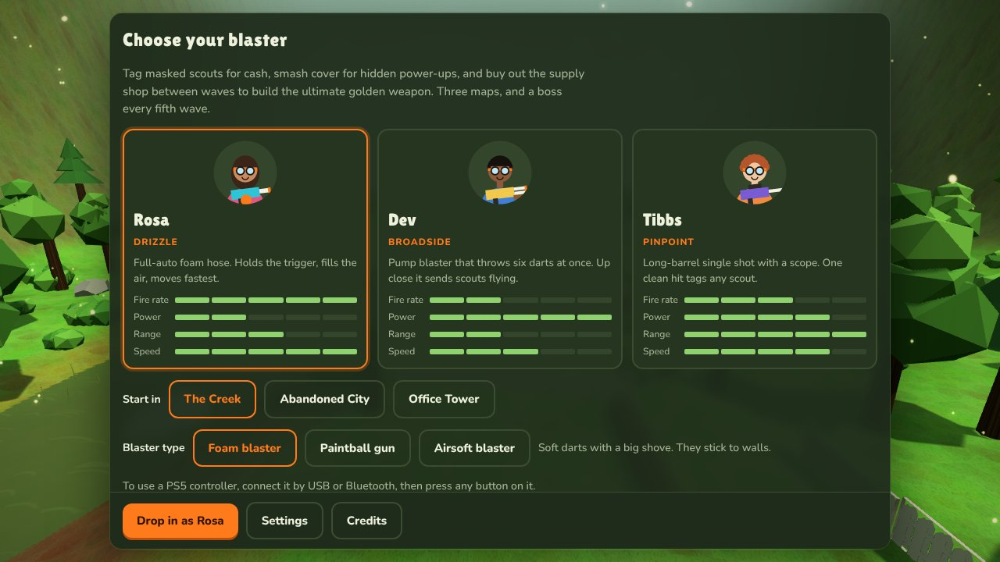
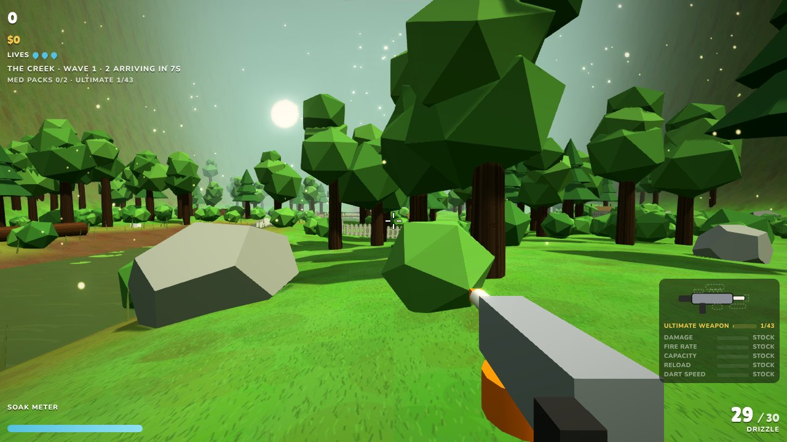
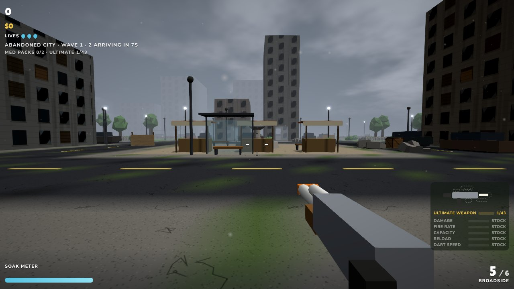
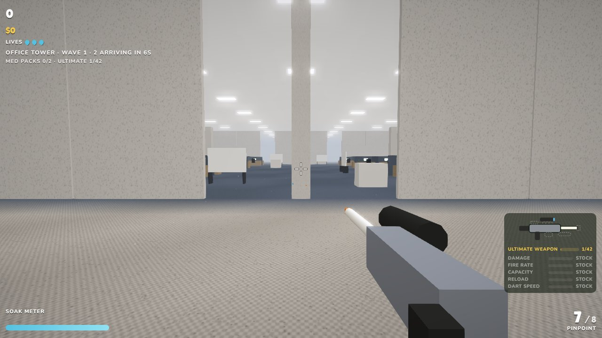

# Gully Foam War

A first-person 3D wave shooter built with three.js that runs in any modern browser and ships as a Windows desktop app. Players tag masked scouts across three procedurally laid-out maps, smash destructible cover for power-ups, and upgrade their blaster between waves.

**[Play in the browser](https://hepmatt.github.io/gully-foam-war/)** · **[Download for Windows](https://github.com/hepmatt/gully-foam-war/releases)**



| The Creek                                | Abandoned City                               | Office Tower                                 |
| ---------------------------------------- | -------------------------------------------- | -------------------------------------------- |
|  |  |  |

## Features

- Three maps (outdoor ravine, city streets, office interior) generated from a seeded random number generator, so each layout is repeatable.
- Enemy AI that patrols, reacts to noise, checks line of sight before firing, and uses elevated perches. A boss arrives every fifth wave.
- Verlet ragdoll physics for tagged enemies, with water drag and terrain collision.
- Destructible cover with per-material hit points and flying debris.
- Three graphics presets, from a low-end mode for laptops and phones to HDR bloom, FXAA and dynamic shadows.
- Keyboard and mouse, PS5 controller, and on-screen touch controls.
- All sound effects synthesized at runtime with the Web Audio API. The game ships no audio files.
- Fully offline: three.js, fonts and assets are bundled in the repo.

## Tech stack

| Area      | Tools                                                              |
| --------- | ------------------------------------------------------------------ |
| Rendering | three.js r128, WebGL, post-processing (bloom, FXAA, color grading) |
| Language  | JavaScript (ES2020), HTML, CSS                                     |
| Desktop   | Electron, electron-builder (NSIS installer and portable .exe)      |
| CI/CD     | GitHub Actions builds the Windows installer on every version tag   |
| Tooling   | Prettier, EditorConfig, npm                                        |

## Architecture

```
index.html          Loads three.js, then settings.js, graphics.js and game.js in order
js/settings.js      Default settings, load and save to localStorage, key names
js/game.js          Game loop, world generation, physics, enemy AI, weapons, shop, audio, input, menus
js/graphics.js      Optional graphics layer: post-processing, sky, textures, shadows, particles
electron/           Desktop window, fullscreen and quit handling
```

Key design decisions:

- **Fixed timestep physics.** The render loop runs at the display's frame rate, but physics advances in fixed 1/60 s steps through an accumulator, so movement and ragdolls behave the same at 30 fps or 144 fps.
- **Graphics layer is optional.** `game.js` calls into `graphics.js` only if it loaded. If the graphics layer is missing or throws, the game falls back to the plain renderer instead of crashing.
- **Fault-tolerant frame loop.** Each frame runs inside an error guard, so one bad frame is logged and skipped instead of freezing the game.
- **Collision with axis-aligned bounding boxes.** World geometry registers AABBs at build time; the player and enemies resolve against them each step.
- **Instanced rendering** for trees and foliage, which keeps draw calls low on large outdoor maps.
- **Software rendering fallback** in the desktop app when a PC's graphics driver is blocked.

## Controls

| Action      | Keyboard and mouse | Controller   |
| ----------- | ------------------ | ------------ |
| Move        | W A S D            | Left stick   |
| Look        | Mouse              | Right stick  |
| Fire        | Left click or F    | R2           |
| Scope       | Right click or Q   | L2           |
| Jump        | Space              | Cross        |
| Crouch      | C                  | Circle or R3 |
| Sprint      | Left Shift         | L3           |
| Reload      | R                  | Square or R1 |
| Swap weapon | X                  | Triangle     |
| Pause       | Esc or P           | Options      |

Every keyboard action can be rebound in **Settings → Controls**.

## Run it locally

In the browser, open `index.html`. No build step or server is needed.

As a desktop app:

```bash
npm install
npm start           # run the Electron app from source
npm run dist:win    # build the installer and portable .exe into dist/
```

Code style is enforced with Prettier:

```bash
npm run format        # format all source files
npm run format:check  # check formatting without changing files
```

## Settings

| Tab      | Options                                                                                                                  |
| -------- | ------------------------------------------------------------------------------------------------------------------------ |
| Display  | Fullscreen, graphics preset, render scale (50 to 100%), field of view (60 to 100°), frame rate counter, frame rate limit |
| Audio    | Master, effects and ambient volume, mute                                                                                 |
| Controls | Mouse and controller sensitivity, invert look, key rebinding for 18 actions                                              |
| Gameplay | Screen shake, crosshair color, reset to defaults                                                                         |

## Roadmap

1. Split `game.js` into ES modules (world, enemies, weapons, audio, UI) with a Vite build.
2. Add unit tests for the pure logic: seeded generation, collision, scoring.
3. Ambient occlusion and a water shader for the creek.
4. Upgrade three.js from r128 to a current release.
5. glTF character models in place of the primitive-shape rigs.

## Credits and licenses

- [three.js](https://threejs.org/) r128, MIT License (`vendor/three/LICENSE`)
- Lilita One and Nunito fonts, SIL Open Font License (`fonts/`)

Game code and art copyright © 2026 Matthew Lynn. All rights reserved.
